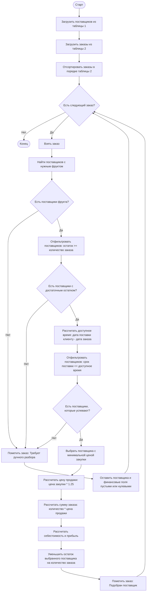

# Задача 1. Алгоритм выбора поставщика и расчета финансов

## Блок-схема

## Краткое описание шагов

1. Загрузить данные поставщиков из таблицы 1 и заказы клиентов из таблицы 2.
2. Обрабатывать заказы последовательно в порядке таблицы 2, потому что после успешного закрытия заказа складской остаток выбранного поставщика уменьшается.
3. Для текущего заказа найти всех поставщиков, у которых `Наименование` совпадает с фруктом заказа.
4. Отфильтровать поставщиков по складу: `Количество на складе >= Количество заказа`.
5. Рассчитать доступное время на поставку: `Срок поставки клиенту - Дата заказа` в днях.
6. Отфильтровать поставщиков по сроку: `Срок поставки поставщика <= доступное время`.
7. Если после фильтрации не осталось ни одного поставщика, присвоить заказу статус `Требует ручного разбора`.
8. Если подходящие поставщики есть, выбрать поставщика с минимальной `Ценой закупки`.
9. Рассчитать финансовые показатели:
   - `Цена продажи = Цена закупки * 1.25`
   - `Сумма заказа = Количество заказа * Цена продажи`
   - `Себестоимость = Количество заказа * Цена закупки`
   - `Прибыль = Сумма заказа - Себестоимость`
10. Уменьшить остаток выбранного поставщика на количество заказа.
11. Присвоить заказу статус `Подобран поставщик` и перейти к следующему заказу.

## Примечания для реализации

- Минимальная наценка по ТЗ составляет 25% от цены закупки.
- Логистика не учитывается.
- Поставщик должен успеть привезти товар до даты поставки клиенту. Если между датой заказа и датой поставки клиенту 2 дня, поставщик со сроком 3 дня не подходит.
- При равной минимальной цене закупки рекомендуется использовать стабильное правило выбора, например поставщика, который раньше встречается в таблице 1. Это сделает результат алгоритма предсказуемым.
- Для заказов со статусом `Требует ручного разбора` поставщик не выбирается, складские остатки не меняются, финансовые поля можно оставить пустыми до ручного решения.
